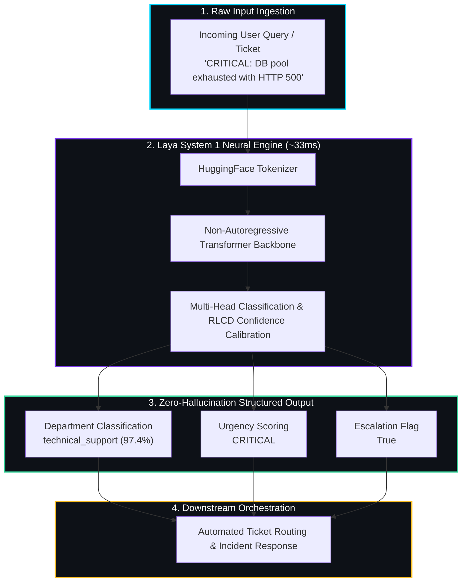

<div align="center">

<!-- Animated Typing Header -->
<a href="https://git.io/typing-svg"></a>

<br/>

<!-- Animated Wave Banner -->


<br/>

<!-- Badges Row 1: Repository Status -->


<br/>

<!-- Badges Row 2: Core Technologies -->
[](https://huggingface.co/convaiinnovations/laya)


<br/>

<!-- Badges Row 3: Developer & Deployment Tooling -->


<br/><br/>

<!-- Profile Views Counter -->


</div>

---


## About This Repository

> *A clean, production-grade showcase and practical experimentation harness for [`convaiinnovations/laya`](https://huggingface.co/convaiinnovations/laya) — the open-source non-autoregressive System 1 decision model that classifies raw text, routes enterprise support tickets, and scores urgency in a single forward pass in ~33 ms.*

Most modern AI solutions (ChatGPT, Claude, LLaMA) rely on **System 2** reasoning: they generate text token-by-token in sequential loops. This is computationally expensive (1,000 to 3,000 ms), costly per token, and prone to hallucinations. 

**Laya embodies System 1 intuition**: fast, non-generative, deterministic, calibrated, and instant.

### Core Architectural Differentiators

| Dimension | Generative LLMs (System 2) | Laya (System 1) |
| :--- | :--- | :--- |
| **Output Type** | Unstructured text stream | Structured JSON payload |
| **Inference Mechanism** | Multi-step autoregressive generation | Single forward pass through network |
| **End-to-End Latency** | 1,000 – 3,000 ms | **~33 ms** (up to 100x faster) |
| **Hallucination Risk** | High (stochastically synthesizes tokens) | **Zero** (purely classifies & scores) |
| **Confidence Scoring** | Uncalibrated token logits | **Calibrated probabilities** via RLCD |
| **Operational Cost** | Variable per-token API billing | **Free, lightweight, fully self-hosted** |
| **Model Footprint** | 7B – 70B+ parameters | **~300 MB compact checkpoint** |
| **Licensing** | Proprietary or restrictive open weights | **Apache 2.0** |

---


## Architectural Pipeline



---


## Quick Start & Setup

### 1. Clone the Repository
```bash
git clone https://github.com/JayanGupta/Laya-System-1-Model.git
cd Laya-System-1-Model
```

### 2. Install Dependencies
```bash
pip install -r requirements.txt
```

> [!NOTE]
> On the first execution, model weights (~300 MB) are automatically fetched from Hugging Face Hub and cached locally. All subsequent runs execute instantly offline.

---


## Live CLI Demonstrations

Test any raw text or support ticket in real-time straight from your terminal using `laya_demo.py`:

```bash
# Outage detection
python laya_demo.py "CRITICAL: Database connection pool exhausted causing HTTP 500 errors"

# Billing dispute
python laya_demo.py "Double charged on invoice #INV-88912"

# Security telemetry
python laya_demo.py "Unrecognized root login detected from foreign IP 203.0.113.42"

# General inquiry
python laya_demo.py "How do I export my dashboard analytics to CSV format?"
```

### Sample Real-Time Terminal Output
```text
--- LAYA DECISION ---
Input:       CRITICAL: Database connection pool exhausted causing HTTP 500 errors
Latency:     33.0 ms
Department:  technical_support  (97.4%)
Urgency:     CRITICAL
Escalation:  True
```

---


## Programmatic Python Usage

### Option A: Using the High-Level `laya_engine.py` Wrapper
```python
from laya_engine import LayaEngine

engine = LayaEngine()
result = engine.predict("Client portal is rendering blank white screens on mobile devices")

print(f"Department: {result.department} (Confidence: {result.confidence:.1%})")
print(f"Urgency:    {result.urgency}")
print(f"Latency:    {result.latency_ms:.1f} ms")
```

### Option B: Pure Hugging Face Transformers (`laya_engine_hf.py`)
```python
import torch
from transformers import AutoTokenizer, AutoModelForSequenceClassification

model_id = "convaiinnovations/laya"
tokenizer = AutoTokenizer.from_pretrained(model_id)
model = AutoModelForSequenceClassification.from_pretrained(model_id)

inputs = tokenizer("Refund requested for subscription cancelled last week", return_tensors="pt")
with torch.no_grad():
    outputs = model(**inputs)
    probabilities = torch.softmax(outputs.logits, dim=-1)

predicted_class = torch.argmax(probabilities, dim=-1).item()
print("Predicted class index:", predicted_class)
```

---


## Repository File Structure

```
Laya-System-1-Model/
|-- README.md                              # Master repository documentation
|-- requirements.txt                       # Project dependencies (torch, transformers)
|-- .gitignore                             # Git ignore specifications
|-- explanation.pdf                        # System 1 architecture & theoretical foundations
|
|-- laya_demo.py                           # Ready-to-run CLI demonstration tool
|-- laya_engine.py                         # Production wrapper with latency telemetry
|-- laya_engine_hf.py                      # Pure Hugging Face transformers implementation
|
|-- experiment/                            # Research & evaluation sandbox
|   `-- laya_notebook.ipynb                # Step-by-step Colab-ready interactive notebook
|
`-- data/                                  # Benchmark test datasets
    |-- tickets_dataset.csv                # Enterprise support tickets (CSV)
    `-- tickets_dataset.json               # Enterprise support tickets (JSON)
```

---


## Contributing

Contributions, issues, and feature requests are welcome:

1. Fork the Project (`https://github.com/JayanGupta/Laya-System-1-Model/fork`)
2. Create your Feature Branch (`git checkout -b feature/NewBenchmark`)
3. Commit your Changes (`git commit -m "feat: add multi-label classification benchmark"`)
4. Push to the Branch (`git push origin feature/NewBenchmark`)
5. Open a Pull Request

---


## Show Your Support

Give a star if this repository helped your understanding of non-autoregressive System 1 models!

<div align="center">

[](https://star-history.com/#JayanGupta/Laya-System-1-Model&Date)

</div>

---

<div align="center">

<!-- Animated Footer Wave -->


<br/>

<b>Engineered for AI Innovation by <a href="https://github.com/JayanGupta">Jayan Gupta</a></b>

<br/><br/>


</div>
